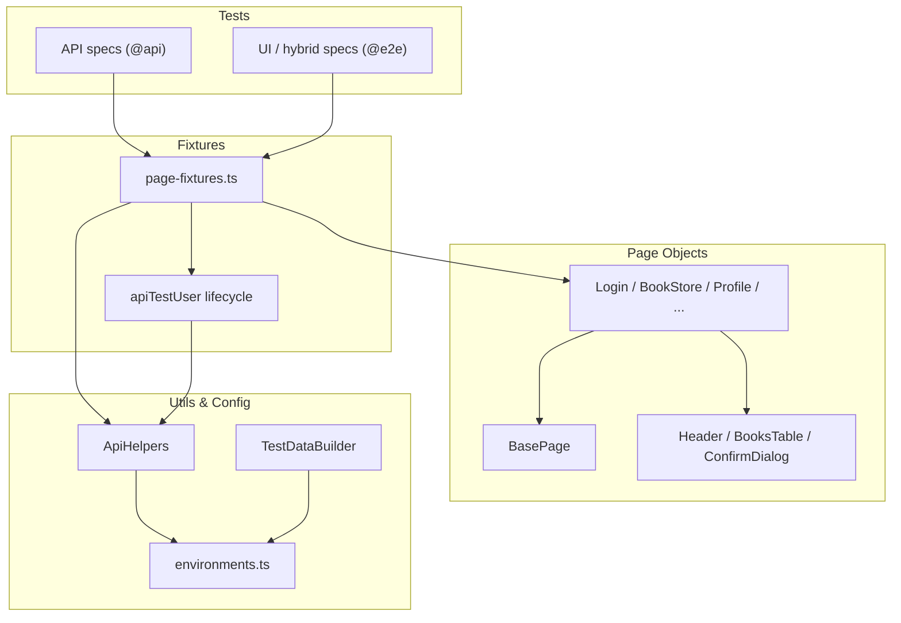

# DemoQA Book Store Test Automation Framework

[](https://github.com/GGrudev/demoqa-bookstore-playwright-ts/actions/workflows/ci.yml)
[](https://github.com/GGrudev/demoqa-bookstore-playwright-ts/actions/workflows/regression.yml)


End-to-end UI and API test automation for the [DemoQA Book Store](https://demoqa.com/books), built with Playwright and TypeScript.

## About

This project demonstrates senior QA automation practices on a public demo application:

- **Layered architecture** — config, fixtures, page objects, API helpers, and tests stay separated by responsibility.
- **Test pyramid** — fast API coverage plus targeted UI and hybrid flows.
- **Isolated test data** — API-created users with automatic cleanup for parallel-safe runs.
- **Hybrid setup** — API preconditions with UI verification for reliable end-to-end scenarios.
- **CI-ready** — lint/typecheck/format on every PR; live DemoQA API/smoke suites stay in CI/CD via manual dispatch, plus weekly/manual full regression.
- **Selective component POM** — shared UI (`Header`, `BooksTable`, `ConfirmDialog`) composed into page objects where reuse pays off.

## Tech Stack

| Layer       | Tools                                                    |
| ----------- | -------------------------------------------------------- |
| Test runner | [Playwright](https://playwright.dev/)                    |
| Language    | TypeScript (strict mode)                                 |
| Patterns    | Page Object Model, component composition, fixtures, tags |
| Quality     | ESLint, Prettier, TypeScript, Zod, axe-core              |
| CI          | GitHub Actions                                           |

## Project Structure

```text
.github/workflows/   Quality CI + scheduled/manual regression
components/          Shared UI components (Header, BooksTable, ConfirmDialog)
config/              Environment config and test data builders
fixtures/            Custom Playwright fixtures and per-test API user lifecycle
schemas/             Zod runtime contracts for DemoQA API request/response shapes
pages/               Page Object classes (compose components + page workflows)
tests/
  api/               API contract and workflow tests (`api` project)
  e2e/               UI and hybrid UI/API tests
utils/               BasePage, API helpers, auth, diagnostics
```

## Architecture



### Layer responsibilities

- `config/` — URLs, credentials, timeouts, and reusable test data builders.
- `utils/api-helpers.ts` — typed client for DemoQA account and book endpoints; validates success responses with Zod.
- `schemas/` — Zod schemas for book and account API contracts (`BookSchema`, `TokenResponseSchema`, etc.).
- `utils/schema-validators.ts` — shared `parseApiResponse` helper for runtime validation.
- `utils/base-page.ts` — minimal shared base: navigation, the composed `Header`, and an assertion helper.
- `components/` — selective component POM: `Header`, `BooksTable`, and `ConfirmDialog` for shared UI/behavior only.
- `pages/` — page-specific workflows that compose those components.
- `fixtures/page-fixtures.ts` — injects page objects, API helpers, and isolated users into tests.
- `utils/test-diagnostics.ts` — attaches user/ISBN context to the report for hybrid failures.
- `tests/` — scenarios using `test.step` and tags such as `@api`, `@e2e`, `@smoke`, `@a11y`.

### Selector priority

When adding locators, prefer (in order): `getByRole` / `getByLabel` → `getByText` → stable `#id` → CSS.

## Test Strategy

| Layer  | Purpose                     | Examples                                          |
| ------ | --------------------------- | ------------------------------------------------- |
| API    | Fast backend validation     | Token generation, book CRUD, Zod contract checks  |
| UI     | User-facing flows           | Login, browse books, book details, profile        |
| Hybrid | Reliable E2E with API setup | Add book via API, verify collection in profile UI |

## Test Data And Isolation

Tests that mutate user state use the `apiTestUser` fixture. It creates a unique DemoQA user through the API before the test and deletes that user afterward. That avoids shared account state and keeps the suite safer for parallel execution.

Static credentials are used for login smoke tests and the shared `storageState` setup user.

```bash
# Recommended locally: copy and edit .env (loaded automatically by Playwright)
cp .env.example .env

# Or set shell variables instead of using .env
# PowerShell
$env:DEMOQA_USERNAME="yourUser"
$env:DEMOQA_PASSWORD="YourPass@123"

# Bash
export DEMOQA_USERNAME="yourUser"
export DEMOQA_PASSWORD="YourPass@123"
```

Locally, missing values fall back to the defaults in `config/environments.ts`. In CI, smoke/e2e/authenticated suites **require** `DEMOQA_USERNAME` and `DEMOQA_PASSWORD` repository secrets and fail fast if they are unset. API-only jobs do not need them.

## Authentication

The suite uses two complementary authentication strategies, depending on whether a test can share a session.

### Shared session via `storageState` (setup project)

Tests that only need a logged-in static user reuse a single session instead of logging in repeatedly:

1. `tests/auth.setup.ts` runs once as the `setup` project — it logs in the static user through the UI and saves the session to `.auth/static-user.json`.
2. The `authenticated` project (`playwright.config.ts`) `dependencies: ['setup']` and loads that file via `use.storageState`.
3. Specs named `*.authenticated.spec.ts` (e.g. `profile-session.authenticated.spec.ts`) run in that project already logged in.

The default `chromium` project ignores `*.authenticated.spec.ts`, so login, logout, and logged-out tests keep starting from a clean session.

### Per-test fixtures (isolated users)

| Fixture           | Purpose                                                                       |
| ----------------- | ----------------------------------------------------------------------------- |
| `apiTestUser`     | Creates and cleans up an isolated API user (no UI login)                      |
| `loggedInApiUser` | Creates an isolated API user and logs it in through the UI (per-test session) |

For **hybrid UI/API tests**, prepare data through the API first, then call `loginViaUi()` from `utils/auth-flow.ts`. DemoQA invalidates the UI session when API calls are made after browser login, so API setup must happen before UI login. Isolated users can't reuse the shared `storageState` because they don't exist until the fixture creates them.

```typescript
// Hybrid pattern
await apiHelpers.addBooksToUser(apiTestUser.userId, apiTestUser.token, [isbn]);
await loginViaUi(page, apiTestUser);
await profilePage.goToProfile();
```

## API Contract Validation

TypeScript interfaces in `api-helpers.ts` describe expected shapes at compile time only. **Zod schemas** in `schemas/` validate real API JSON at runtime.

Successful responses from `ApiHelpers` are parsed against schemas such as `BooksListSchema`, `BookSchema`, `TokenResponseSchema`, and `UserResponseSchema`. If DemoQA returns an unexpected type or missing field, tests fail with a clear Zod error path (for example `books[0].pages`).

Error payloads can be validated explicitly in tests:

```typescript
const error = parseApiResponse(ApiErrorSchema, response.body);
expect(error.code).toBe('1207');
```

## CI/CD Pipeline

Two workflows keep **PR quality checks** separate from **live DemoQA traffic**, while still keeping API and smoke runs available in CI/CD.

### CI (`ci.yml`) — push, pull request, and manual dispatch

| Trigger             | What runs                                                            |
| ------------------- | -------------------------------------------------------------------- |
| **Push / PR**       | Lint + typecheck + format only (no DemoQA traffic)                   |
| **Manual dispatch** | Quality gate, then optional `api`, `smoke`, or `both` against DemoQA |

Trigger live suites from GitHub: **Actions → CI → Run workflow** and choose the suite.

| Manual suite | What it runs                     |
| ------------ | -------------------------------- |
| `none`       | Quality gate only                |
| `api`        | `npm run test:api` (4 workers)   |
| `smoke`      | `npm run test:smoke` (2 workers) |
| `both`       | API + smoke jobs in parallel     |

### Regression (`regression.yml`) — manual & weekly schedule

Trigger from GitHub: **Actions → Regression → Run workflow**

| Suite option         | What runs                                   |
| -------------------- | ------------------------------------------- |
| `smoke`              | Critical `@smoke` tests only                |
| `api`                | All `@api` tests                            |
| `e2e`                | Chromium UI/hybrid projects                 |
| `regression` / `all` | API + E2E jobs **in parallel** (full suite) |

- **Schedule:** full regression weekly (Sunday 06:00 UTC)
- **Workers:** choose 1, 2, or 4 parallel Playwright workers per job (default: 2)
- API-only matrix jobs skip Chromium install

Failed live-test runs upload Playwright HTML reports, JUnit XML, and failure artifacts. JUnit results are published to the GitHub Checks tab.

### Parallel execution

Playwright runs tests in parallel at two levels:

1. **Within a job** — `fullyParallel: true` and `PLAYWRIGHT_WORKERS` (configurable in Actions)
2. **Across jobs** — regression API + E2E run as separate parallel GitHub Actions jobs

Locally:

```bash
# Default: Playwright picks worker count from CPU cores
npm test

# Override worker count
PLAYWRIGHT_WORKERS=4 npm run test:api
```

### Sharding (splitting the suite across machines)

**Workers** parallelize tests on one machine. **Sharding** splits the test list across multiple CI runners.

| Concept  | Scope                              |
| -------- | ---------------------------------- |
| Workers  | One machine, N browser processes   |
| Sharding | M machines, each runs 1/M of tests |

This suite is small enough that workers + parallel jobs are sufficient today. Use the shard scripts above to experiment locally; add CI sharding via `--shard=x/y` when the suite grows beyond ~100 tests.

Quick local example:

```bash
npm run test:shard:1   # first half of the suite
npm run test:shard:2   # second half
```

### Required CI secrets (UI suites)

For manual CI smoke and regression e2e/authenticated runs, add repository secrets:

| Secret            | Description                                     |
| ----------------- | ----------------------------------------------- |
| `DEMOQA_USERNAME` | DemoQA username for UI smoke / regression tests |
| `DEMOQA_PASSWORD` | DemoQA password for UI smoke / regression tests |

Quality-only PR checks and API-only jobs do not need these secrets.

## Setup

```bash
git clone https://github.com/GGrudev/demoqa-bookstore-playwright-ts.git
cd demoqa-bookstore-playwright-ts
npm install
npx playwright install
cp .env.example .env   # optional local credential overrides
```

## Running Tests

```bash
# Run all tests
npm test

# Run only E2E/UI and hybrid tests
npm run test:e2e

# Run only API tests
npm run test:api

# Run smoke tests
npm run test:smoke

# Run full regression suite (all tests)
npm run test:regression

# Run half the suite (sharding demo)
npm run test:shard:1
npm run test:shard:2

# Run in headed mode
npm run test:headed

# Open Playwright UI mode
npm run test:ui

# Debug tests
npm run test:debug

# View HTML report
npm run test:report

# Lint and format
npm run lint
npm run format:check
```

## Debugging Failures

1. **HTML report** — `npm run test:report` (or download the `playwright-report-*` CI artifact).
2. **Trace** — open a failed test’s `trace.zip` with `npx playwright show-trace <path>` (retained on failure locally; on first retry in CI).
3. **Hybrid context** — collection tests attach `collection-context` JSON (`userId`, ISBN, title) via `utils/test-diagnostics.ts`.
4. **JUnit / Checks** — CI publishes JUnit to the GitHub Checks tab and uploads `test-results-*` on failure.

## API Coverage

**Account workflows**

- Create isolated users through API fixtures
- Generate tokens for valid and invalid users
- Check authorization
- Fetch user details by user id and bearer token
- Delete users during fixture cleanup

**Book-store workflows**

- Fetch all books
- Fetch one book by ISBN
- Validate known books are present
- Add a book to a user collection
- Replace a book in a user collection
- Delete a book from a user collection
- Verify collection state through the user endpoint

## Known DemoQA Limitations

DemoQA protects UI registration with reCAPTCHA, so the project does not automate the full UI registration submit flow. The `RegisterPage` object and login-to-register navigation test validate navigation and form visibility only. User creation for test setup is handled through the API.

The application is a public demo site, so occasional upstream slowness or data resets are possible. API-created users and automatic cleanup reduce the impact of shared environment state.

## Planned Improvements

- Add Docker support for a portable test execution environment
- Expand axe coverage beyond the login page when targeting multi-page a11y gates
- Path aliases for shorter imports across pages/fixtures/utils

## License

MIT
