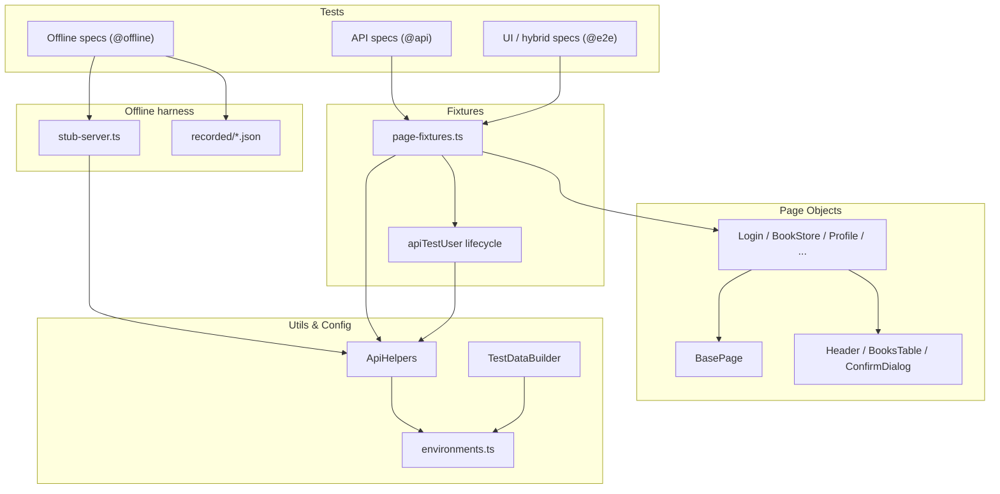

# DemoQA Book Store Test Automation Framework

[](https://github.com/GGrudev/demoqa-bookstore-playwright-ts/actions/workflows/ci.yml)
[](https://github.com/GGrudev/demoqa-bookstore-playwright-ts/actions/workflows/regression.yml)


End-to-end UI and API test automation for the [DemoQA Book Store](https://demoqa.com/books), built with Playwright and TypeScript.

## About

This project demonstrates senior QA automation practices on a public demo application:

- **Layered architecture** — config, fixtures, page objects, API helpers, and tests stay separated by responsibility.
- **Test pyramid** — an offline base of contract and client tests, fast API coverage, then targeted UI and hybrid flows.
- **Runs without the system under test** — recorded payloads and an in-process stub server let a real suite gate every pull request with zero DemoQA traffic.
- **Isolated test data** — API-created users with automatic cleanup for parallel-safe runs.
- **Hybrid setup** — API preconditions with UI verification for reliable end-to-end scenarios.
- **CI-ready** — lint/typecheck/format plus the offline suite on every PR; live DemoQA API/smoke suites stay in CI/CD via manual dispatch, plus weekly/manual full regression.
- **Selective component POM** — shared UI (`Header`, `BooksTable`, `ConfirmDialog`) composed into page objects where reuse pays off.

## Tech Stack

| Layer       | Tools                                                    |
| ----------- | -------------------------------------------------------- |
| Test runner | [Playwright](https://playwright.dev/)                    |
| Language    | TypeScript (strict mode)                                 |
| Patterns    | Page Object Model, component composition, fixtures, tags |
| Quality     | ESLint, Prettier, TypeScript, Zod, axe-core              |
| CI          | GitHub Actions                                           |

## Project Structure

```text
.github/workflows/   Quality CI + scheduled/manual regression
components/          Shared UI components (Header, BooksTable, ConfirmDialog)
config/              Environment config and test data builders
fixtures/            Custom Playwright fixtures and per-test API user lifecycle
schemas/             Zod runtime contracts for DemoQA API request/response shapes
pages/               Page Object classes (compose components + page workflows)
tests/
  offline/           Contract + API-client tests against recorded payloads and a stub server
  api/               API contract and workflow tests (`api` project)
  e2e/               UI and hybrid UI/API tests
utils/               BasePage, API helpers, auth, diagnostics
```

## Architecture



### Layer responsibilities

- `config/` — URLs, credentials, timeouts, and reusable test data builders. Every wait used by a page object, component, or spec comes from `getTimeouts()`; millisecond literals are not inlined at call sites.
- `utils/api-helpers.ts` — typed client for DemoQA account and book endpoints. Returns responses verbatim and validates outgoing payloads; response contracts are asserted by the specs.
- `schemas/` — Zod schemas for book and account API contracts (`BookSchema`, `TokenResponseSchema`, etc.), plus loose setup envelopes used by fixtures.
- `utils/schema-validators.ts` — shared `parseApiResponse` helper for runtime validation.
- `tests/offline/` — stub server, recorded DemoQA payloads, and the specs that run without network access.
- `utils/base-page.ts` — minimal shared base: navigation, the composed `Header`, and an assertion helper.
- `components/` — selective component POM: `Header`, `BooksTable`, and `ConfirmDialog` for shared UI/behavior only. `BooksTable` takes the wrapper it lives under, because Book Store and Profile render the same table in different containers.
- `pages/` — page-specific workflows that compose those components.
- `fixtures/page-fixtures.ts` — injects page objects, API helpers, and isolated users into tests. It also declares `apiBaseUrl` as a Playwright option, so the API host is configured in `playwright.config.ts` beside `baseURL` and can be overridden per project instead of each client reading environment config itself.
- `utils/test-diagnostics.ts` — attaches user/ISBN context to the report for hybrid failures.
- `tests/` — scenarios using `test.step` and tags such as `@api`, `@e2e`, `@smoke`, `@a11y`.

### Selector priority

When adding locators, prefer (in order): `getByRole` / `getByLabel` → `getByText` → stable `#id` → CSS.

### Import paths

Cross-directory imports use TypeScript path aliases (`@components/*`, `@config/*`, `@fixtures/*`, `@pages/*`, `@schemas/*`, `@utils/*`), declared once in `tsconfig.json` and resolved by both `tsc` and Playwright. Moving a spec between folders no longer changes its imports, and `../../../` chains are gone. Same-directory imports stay relative, since an alias there would only add noise.

## Test Strategy

| Layer   | Purpose                     | Examples                                                        |
| ------- | --------------------------- | --------------------------------------------------------------- |
| Offline | Deterministic, no network   | Schema drift detection, `ApiHelpers` request/response behaviour |
| API     | Fast backend validation     | Token generation, book CRUD, Zod contract checks                |
| UI      | User-facing flows           | Login, browse books, book details, profile                      |
| Hybrid  | Reliable E2E with API setup | Add book via API, verify collection in profile UI               |

### Offline suite

DemoQA is a shared public site: it can be slow, reset its data, or be down entirely. That makes it a poor gate for a pull request, but it is not a reason to ship a pipeline that only runs a linter. The `offline` project closes that gap and runs on every push and PR:

- **Contract tests** (`tests/offline/contracts/`) parse payloads recorded from DemoQA against the Zod schemas. Alongside the happy paths, they assert that an added, removed, retyped, or malformed field is _rejected_ — so the schemas are proven to catch drift rather than assumed to.
- **API client tests** (`tests/offline/api-client/`) run the real `ApiHelpers` against an in-process stub server (`tests/offline/stub-server.ts`) that records what the client sent. They cover bearer headers, URL and query construction, request payload mapping, error passthrough, and the `createUserAndGetToken` setup helper.

The whole project runs in a few seconds, needs no browser, and needs no credentials.

### Cross-browser strategy

Chromium is the gate: it runs in CI and on every local `npm test`. Firefox and WebKit are wired as projects but stay opt-in, via `npm run test:cross-browser` or the regression workflow's `cross-browser` / `all` suite options.

That is a deliberate split rather than a gap. The system under test is a third-party demo site, so rendering differences between engines are not a defect this suite can act on, and running three engines against a shared public site on every push triples the traffic for very little signal. Keeping the projects configured means the matrix is one command away when it is needed — before a release, or when chasing an engine-specific bug — without paying for it on every run. The regression workflow installs only the engines a given job actually uses, so the API job downloads no browser at all and the cross-browser job skips Chromium.

### Accessibility

`tests/e2e/login/login-a11y.spec.ts` runs axe against WCAG 2.0/2.1 A and AA rules. DemoQA embeds Google Ads iframes whose creatives ship unlabelled images, and the upstream ToolsQA banner has no `alt` text — none of it ours to fix, and the ad slots differ between page loads. The scan excludes those two regions by selector rather than disabling the `image-alt` rule, so the rule stays active on the application's own markup. Suppressing a rule to get a green run only removes the check; scoping the scan keeps it.

## Test Data And Isolation

Tests that mutate user state use the `apiTestUser` fixture. It creates a unique DemoQA user through the API before the test and deletes that user afterward. That avoids shared account state and keeps the suite safer for parallel execution.

Cleanup is treated as housekeeping, not as a result. Teardown talks to a public demo site, so a failure there says nothing about the test that just ran and does not fail it. Instead the fixture annotates the test with `cleanup-failed` and records the account in `.test-users/leaked-users.jsonl`, and `utils/global-teardown.ts` retries the deletion once the run finishes. Anything still undeletable stays in that file and is reported on the console, so leaked accounts are visible rather than silent.

Static credentials are used for login smoke tests and the shared `storageState` setup user.

```bash
# Recommended locally: copy and edit .env (loaded automatically by Playwright)
cp .env.example .env

# Or set shell variables instead of using .env
# PowerShell
$env:DEMOQA_USERNAME="yourUser"
$env:DEMOQA_PASSWORD="YourPass@123"

# Bash
export DEMOQA_USERNAME="yourUser"
export DEMOQA_PASSWORD="YourPass@123"
```

Locally, missing values fall back to the defaults in `config/environments.ts`. In CI, smoke/e2e/authenticated suites **require** `DEMOQA_USERNAME` and `DEMOQA_PASSWORD` repository secrets and fail fast if they are unset. API-only and offline jobs do not need them.

## Authentication

The suite uses two complementary authentication strategies, depending on whether a test can share a session.

### Shared session via `storageState` (setup project)

Tests that only need a logged-in static user reuse a single session instead of logging in repeatedly:

1. `tests/auth.setup.ts` runs once as the `setup` project — it logs in the static user through the UI and saves the session to `.auth/static-user.json`.
2. The `authenticated` project (`playwright.config.ts`) `dependencies: ['setup']` and loads that file via `use.storageState`.
3. Specs named `*.authenticated.spec.ts` (e.g. `profile-session.authenticated.spec.ts`) run in that project already logged in.

The default `chromium` project ignores `*.authenticated.spec.ts`, so login, logout, and logged-out tests keep starting from a clean session.

### Per-test fixtures (isolated users)

| Fixture           | Purpose                                                                       |
| ----------------- | ----------------------------------------------------------------------------- |
| `apiTestUser`     | Creates and cleans up an isolated API user (no UI login)                      |
| `loggedInApiUser` | Creates an isolated API user and logs it in through the UI (per-test session) |

For **hybrid UI/API tests**, prepare data through the API first, then call `loginViaUi()` from `utils/auth-flow.ts`. DemoQA invalidates the UI session when API calls are made after browser login, so API setup must happen before UI login. Isolated users can't reuse the shared `storageState` because they don't exist until the fixture creates them.

```typescript
// Hybrid pattern
await apiHelpers.addBooksToUser(apiTestUser.userId, apiTestUser.token, [isbn]);
await loginViaUi(page, apiTestUser);
await profilePage.goToProfile();
```

## API Contract Validation

TypeScript types describe expected shapes at compile time only. **Zod schemas** in `schemas/` validate real API JSON at runtime, and if DemoQA returns an unexpected type or a missing field, tests fail with a clear error path (for example `books[0].pages`).

Where that validation happens is a deliberate choice. `ApiHelpers` is used for test _setup_ as well as for assertions, so it returns every response body verbatim as `unknown` and never decides which contract applies:

```typescript
// Specs parse the schema that fits their scenario.
const books = parseApiResponse(BooksListSchema, response.body);
const error = parseApiResponse(ApiErrorSchema, response.body);
expect(error.code).toBe('1207');
```

If the client parsed strict contracts internally, a single added field on DemoQA's side would fail every UI test that merely creates a user during setup — burying one real finding under a pile of unrelated red. Instead:

| Concern                                   | Where it lives                                     | Strictness                                 |
| ----------------------------------------- | -------------------------------------------------- | ------------------------------------------ |
| Contract enforcement                      | API and offline specs                              | `z.strictObject` — rejects drift           |
| Setup (fixtures, `createUserAndGetToken`) | `CreatedUserEnvelopeSchema`, `TokenEnvelopeSchema` | `z.looseObject` — only the fields consumed |
| Outgoing request payloads                 | `ApiHelpers`                                       | Strict — a bad request is a test bug       |

The offline suite asserts this split directly: the same drifted payload must fail the strict contract and pass the setup envelope.

## CI/CD Pipeline

Two workflows keep **PR checks** separate from **live DemoQA traffic**, while still keeping API and smoke runs available in CI/CD.

### CI (`ci.yml`) — push, pull request, and manual dispatch

| Trigger             | What runs                                                             |
| ------------------- | --------------------------------------------------------------------- |
| **Push / PR**       | Lint + typecheck + format, then the offline suite (no DemoQA traffic) |
| **Manual dispatch** | The above, then optional `api`, `smoke`, or `both` against DemoQA     |

The quality gate is enforcing: `npm run lint` runs ESLint 9 flat config (`eslint.config.mjs`) with `--max-warnings=0`, and the project's custom rules (`no-explicit-any`, `no-unused-vars`, `playwright/expect-expect`) are errors, so a warning fails the build rather than scrolling past.

Trigger live suites from GitHub: **Actions → CI → Run workflow** and choose the suite.

| Manual suite | What it runs                     |
| ------------ | -------------------------------- |
| `none`       | Quality gate only                |
| `api`        | `npm run test:api` (4 workers)   |
| `smoke`      | `npm run test:smoke` (2 workers) |
| `both`       | API + smoke jobs in parallel     |

### Regression (`regression.yml`) — manual & weekly schedule

Trigger from GitHub: **Actions → Regression → Run workflow**

| Suite option    | What runs                                      |
| --------------- | ---------------------------------------------- |
| `smoke`         | Critical `@smoke` tests only                   |
| `api`           | All `@api` tests                               |
| `e2e`           | Chromium UI/hybrid projects                    |
| `cross-browser` | The same UI specs on Firefox and WebKit        |
| `regression`    | API + E2E jobs **in parallel**                 |
| `all`           | API + E2E + cross-browser jobs **in parallel** |

- **Schedule:** full regression weekly (Sunday 06:00 UTC)
- **Workers:** choose 1, 2, or 4 parallel Playwright workers per job (default: 2)
- Each matrix job installs only the browsers it runs; the API job installs none

Failed live-test runs upload Playwright HTML reports, JUnit XML, and failure artifacts. JUnit results are published to the GitHub Checks tab, and in CI the `github` reporter annotates failures inline on the pull request diff so a reviewer sees the failing assertion without opening a log or downloading an artifact.

### Parallel execution

Playwright runs tests in parallel at two levels:

1. **Within a job** — `fullyParallel: true` and `PLAYWRIGHT_WORKERS` (configurable in Actions)
2. **Across jobs** — regression API + E2E run as separate parallel GitHub Actions jobs

Locally:

```bash
# Default: Playwright picks worker count from CPU cores
npm test

# Override worker count
PLAYWRIGHT_WORKERS=4 npm run test:api
```

### Sharding (splitting the suite across machines)

**Workers** parallelize tests on one machine. **Sharding** splits the test list across multiple CI runners.

| Concept  | Scope                              |
| -------- | ---------------------------------- |
| Workers  | One machine, N browser processes   |
| Sharding | M machines, each runs 1/M of tests |

This suite is small enough that workers + parallel jobs are sufficient today. Use the shard scripts above to experiment locally; add CI sharding via `--shard=x/y` when the suite grows beyond ~100 tests.

Quick local example:

```bash
npm run test:shard:1   # first half of the suite
npm run test:shard:2   # second half
```

### Required CI secrets (UI suites)

For manual CI smoke and regression e2e/authenticated runs, add repository secrets:

| Secret            | Description                                     |
| ----------------- | ----------------------------------------------- |
| `DEMOQA_USERNAME` | DemoQA username for UI smoke / regression tests |
| `DEMOQA_PASSWORD` | DemoQA password for UI smoke / regression tests |

Quality-only PR checks and API-only jobs do not need these secrets.

## Setup

Requires Node.js 20.19 or newer (CI runs Node 22).

```bash
git clone https://github.com/GGrudev/demoqa-bookstore-playwright-ts.git
cd demoqa-bookstore-playwright-ts
npm install
npx playwright install          # or `npx playwright install chromium` for the default gate
cp .env.example .env            # optional local credential overrides
```

## Running Tests

```bash
# Standard gate: offline + API + Chromium UI + authenticated
npm test

# Run only E2E/UI and hybrid tests
npm run test:e2e

# Run only API tests
npm run test:api

# Run the offline suite (no network, no browser, no credentials)
npm run test:offline

# Run smoke tests
npm run test:smoke

# Run the UI specs on Firefox and WebKit
npm run test:cross-browser

# Run everything, including cross-browser
npm run test:regression

# Run half the suite (sharding demo)
npm run test:shard:1
npm run test:shard:2

# Run in headed mode
npm run test:headed

# Open Playwright UI mode
npm run test:ui

# Debug tests
npm run test:debug

# View HTML report
npm run test:report

# Lint and format
npm run lint
npm run format:check
```

## Debugging Failures

1. **HTML report** — `npm run test:report` (or download the `playwright-report-*` CI artifact).
2. **Trace** — open a failed test’s `trace.zip` with `npx playwright show-trace <path>` (retained on failure locally; on first retry in CI).
3. **Hybrid context** — collection tests attach `collection-context` JSON (`userId`, ISBN, title) via `utils/test-diagnostics.ts`.
4. **Annotations** — `cleanup-failed` marks a test whose isolated user could not be deleted; `latency` records measured API response times without gating on them.
5. **JUnit / Checks** — CI publishes JUnit to the GitHub Checks tab and uploads `test-results-*` on failure.

## API Coverage

**Account workflows**

- Create isolated users through API fixtures
- Generate tokens for valid and invalid users
- Check authorization
- Fetch user details by user id and bearer token
- Delete users during fixture cleanup

**Book-store workflows**

- Fetch all books
- Fetch one book by ISBN
- Validate known books are present
- Add a book to a user collection
- Replace a book in a user collection
- Delete a book from a user collection
- Verify collection state through the user endpoint

## Known DemoQA Limitations

DemoQA protects UI registration with reCAPTCHA, so the project does not automate the full UI registration submit flow. The `RegisterPage` object and login-to-register navigation test validate navigation and form visibility only. User creation for test setup is handled through the API.

"Delete All Books" clears the collection server-side but does not re-render the profile table, so the deleted rows stay on screen until the page is loaded again. `ProfilePage.deleteAllBooks()` reloads before asserting. Deleting a single book does re-render, so only the bulk action needs this.

The application is a public demo site, so occasional upstream slowness or data resets are possible. API-created users and automatic cleanup reduce the impact of shared environment state.

## Planned Improvements

- Add Docker support for a portable test execution environment
- Expand axe coverage beyond the login page when targeting multi-page a11y gates
- Publish the HTML report to GitHub Pages, and switch CI to the `blob` reporter with `merge-reports` once the suite is large enough to shard across runners

## License

MIT
