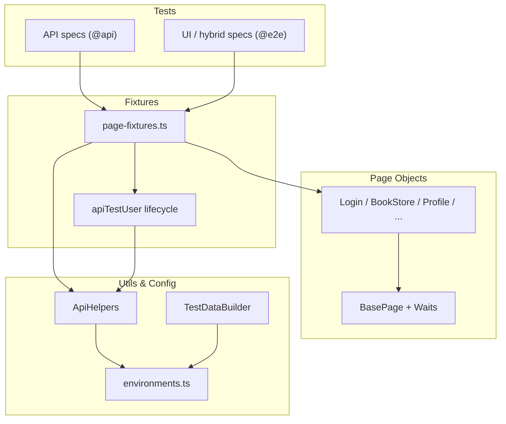

# DemoQA Book Store Test Automation Framework

[](https://github.com/YOUR_GITHUB_USERNAME/demoqa-bookstore/actions/workflows/ci.yml)


End-to-end UI and API test automation for the [DemoQA Book Store](https://demoqa.com/books), built with Playwright and TypeScript.

## About

This project demonstrates senior QA automation practices on a public demo application:

- **Layered architecture** — config, fixtures, page objects, API helpers, and tests stay separated by responsibility.
- **Test pyramid** — fast API coverage plus targeted UI and hybrid flows.
- **Isolated test data** — API-created users with automatic cleanup for parallel-safe runs.
- **Hybrid setup** — API preconditions with UI verification for reliable end-to-end scenarios.
- **CI-ready** — lint, format checks, API tests, and smoke tests run on every push via GitHub Actions.

> **Note:** Replace `YOUR_GITHUB_USERNAME` in the CI badge URL after you push the repository to GitHub.

## Tech Stack

| Layer       | Tools                                         |
| ----------- | --------------------------------------------- |
| Test runner | [Playwright](https://playwright.dev/)         |
| Language    | TypeScript (strict mode)                      |
| Patterns    | Page Object Model, custom fixtures, test tags |
| Quality     | ESLint, Prettier, Zod (API contracts)         |
| CI          | GitHub Actions                                |

## Project Structure

```text
.github/workflows/   CI pipeline (lint, format, API, smoke)
config/              Environment config and test data builders
fixtures/            Custom Playwright fixtures and per-test API user lifecycle
schemas/             Zod runtime contracts for DemoQA API responses
pages/               Page Object classes
tests/
  api/               API contract and workflow tests
  e2e/               UI and hybrid UI/API tests
utils/               BasePage, waits, and API helpers
```

## Architecture



### Layer responsibilities

- `config/` — URLs, credentials, timeouts, and reusable test data builders.
- `utils/api-helpers.ts` — typed client for DemoQA account and book endpoints; validates success responses with Zod.
- `schemas/` — Zod schemas for book and account API contracts (`BookSchema`, `TokenResponseSchema`, etc.).
- `utils/schema-validators.ts` — shared `parseApiResponse` helper for runtime validation.
- `utils/base-page.ts` and `utils/waits.ts` — shared UI interactions and waits.
- `pages/` — page-specific locators and workflows.
- `fixtures/page-fixtures.ts` — injects page objects, API helpers, and isolated users into tests.
- `tests/` — scenarios using `test.step` and tags such as `@api`, `@e2e`, `@smoke`.

## Test Strategy

| Layer  | Purpose                     | Examples                                          |
| ------ | --------------------------- | ------------------------------------------------- |
| API    | Fast backend validation     | Token generation, book CRUD, Zod contract checks  |
| UI     | User-facing flows           | Login, browse books, book details, profile        |
| Hybrid | Reliable E2E with API setup | Add book via API, verify collection in profile UI |

## Test Data And Isolation

Tests that mutate user state use the `apiTestUser` fixture. It creates a unique DemoQA user through the API before the test and deletes that user afterward. That avoids shared account state and keeps the suite safer for parallel execution.

Static credentials can be supplied for login smoke tests:

```bash
# PowerShell
$env:DEMOQA_USERNAME="yourUser"
$env:DEMOQA_PASSWORD="YourPass@123"

# Bash
export DEMOQA_USERNAME="yourUser"
export DEMOQA_PASSWORD="YourPass@123"
```

Copy `.env.example` to `.env` for local overrides. Default fallback credentials live in `config/environments.ts`.

## Authentication Fixtures

The framework provides reusable login fixtures that persist browser state with Playwright `storageState`:

| Fixture           | Purpose                                                                       |
| ----------------- | ----------------------------------------------------------------------------- |
| `loggedInUser`    | Logs in with static/env credentials and saves session state under `.auth/`    |
| `loggedInApiUser` | Creates an isolated API user, logs in through the UI, and saves session state |
| `apiTestUser`     | Creates and cleans up an isolated API user without UI login                   |

For **hybrid UI/API tests**, prepare data through the API first, then call `loginViaUiWithoutStorageState()` from `utils/auth-flow.ts`. DemoQA invalidates the UI session when API calls are made after browser login, so API setup must happen before UI login in those scenarios.

```typescript
// Hybrid pattern
await apiHelpers.addBooksToUser(apiTestUser.userId, apiTestUser.token, [isbn]);
await loginViaUiWithoutStorageState(page, apiTestUser);
await profilePage.goToProfile();
```

## API Contract Validation

TypeScript interfaces in `api-helpers.ts` describe expected shapes at compile time only. **Zod schemas** in `schemas/` validate real API JSON at runtime.

Successful responses from `ApiHelpers` are parsed against schemas such as `BooksListSchema`, `BookSchema`, `TokenResponseSchema`, and `UserResponseSchema`. If DemoQA returns an unexpected type or missing field, tests fail with a clear Zod error path (for example `books[0].pages`).

Error payloads can be validated explicitly in tests:

```typescript
const error = parseApiResponse(ApiErrorSchema, response.body);
expect(error.code).toBe('1207');
```

## CI/CD Pipeline

Two GitHub Actions workflows cover fast PR checks and on-demand/full regression.

### CI (`ci.yml`) — every push & pull request

| Job               | What it runs         | Parallelism |
| ----------------- | -------------------- | ----------- |
| **Lint & format** | ESLint + Prettier    | —           |
| **API tests**     | `npm run test:api`   | 4 workers   |
| **Smoke tests**   | `npm run test:smoke` | 2 workers   |

API and smoke jobs run **in parallel** after the quality gate passes.

### Regression (`regression.yml`) — manual & nightly

Trigger from GitHub: **Actions → Regression → Run workflow**

| Suite option         | What runs                                   |
| -------------------- | ------------------------------------------- |
| `smoke`              | Critical `@smoke` tests only                |
| `api`                | All `@api` tests                            |
| `e2e`                | All `@e2e` UI/hybrid tests                  |
| `regression` / `all` | API + E2E jobs **in parallel** (full suite) |

- **Schedule:** full regression nightly at 06:00 UTC
- **Workers:** choose 1, 2, or 4 parallel Playwright workers per job (default: 2)

Failed runs upload Playwright HTML reports and test artifacts for debugging.

JUnit XML is written to `test-results/junit.xml` on every run. CI publishes results to the GitHub Checks tab and uploads JUnit artifacts for download.

### Parallel execution

Playwright runs tests in parallel at two levels:

1. **Within a job** — `fullyParallel: true` and `PLAYWRIGHT_WORKERS` (configurable in Actions)
2. **Across jobs** — API and smoke/regression API+E2E jobs run as separate parallel GitHub Actions jobs

Locally:

```bash
# Default: Playwright picks worker count from CPU cores
npm test

# Override worker count
PLAYWRIGHT_WORKERS=4 npm run test:api
```

### Sharding (splitting the suite across machines)

**Workers** parallelize tests on one machine. **Sharding** splits the test list across multiple CI runners.

| Concept  | Scope                              |
| -------- | ---------------------------------- |
| Workers  | One machine, N browser processes   |
| Sharding | M machines, each runs 1/M of tests |

This suite is small enough that workers + parallel jobs are sufficient today. Use the shard scripts above to experiment locally; add CI sharding via `--shard=x/y` when the suite grows beyond ~100 tests.

Quick local example:

```bash
npm run test:shard:1   # first half of the suite
npm run test:shard:2   # second half
```

### Optional CI secrets

Smoke login tests use fallback credentials by default. For a dedicated CI account, add repository secrets:

| Secret            | Description                        |
| ----------------- | ---------------------------------- |
| `DEMOQA_USERNAME` | DemoQA username for UI smoke tests |
| `DEMOQA_PASSWORD` | DemoQA password for UI smoke tests |

## Setup

```bash
git clone https://github.com/YOUR_GITHUB_USERNAME/demoqa-bookstore.git
cd demoqa-bookstore
npm install
npx playwright install
```

## Running Tests

```bash
# Run all tests
npm test

# Run only E2E/UI and hybrid tests
npm run test:e2e

# Run only API tests
npm run test:api

# Run smoke tests
npm run test:smoke

# Run full regression suite (all tests)
npm run test:regression

# Run half the suite (sharding demo)
npm run test:shard:1
npm run test:shard:2

# Run in headed mode
npm run test:headed

# Open Playwright UI mode
npm run test:ui

# Debug tests
npm run test:debug

# View HTML report
npm run test:report

# Lint and format
npm run lint
npm run format:check
```

## API Coverage

**Account workflows**

- Create isolated users through API fixtures
- Generate tokens for valid and invalid users
- Check authorization
- Fetch user details by user id and bearer token
- Delete users during fixture cleanup

**Book-store workflows**

- Fetch all books
- Fetch one book by ISBN
- Validate known books are present
- Add a book to a user collection
- Replace a book in a user collection
- Delete a book from a user collection
- Verify collection state through the user endpoint

## Known DemoQA Limitations

DemoQA protects UI registration with reCAPTCHA, so the project does not automate the full UI registration submit flow. The `RegisterPage` object and login-to-register navigation test validate navigation and form visibility only. User creation for test setup is handled through the API.

The application is a public demo site, so occasional upstream slowness or data resets are possible. API-created users and automatic cleanup reduce the impact of shared environment state.

## Publishing To GitHub

```bash
git init
git add .
git commit -m "Initial commit: Playwright Book Store automation framework"
git branch -M main
git remote add origin https://github.com/YOUR_GITHUB_USERNAME/demoqa-bookstore.git
git push -u origin main
```

After pushing, update the CI badge URL in this README with your GitHub username.

## Planned Improvements

- Add Docker support for a portable test execution environment

## License

MIT
