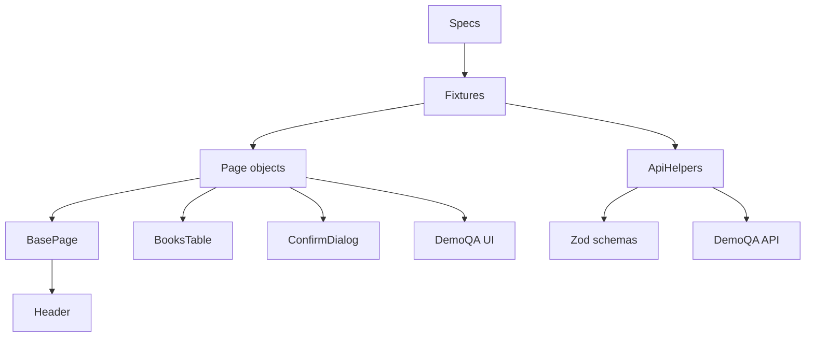
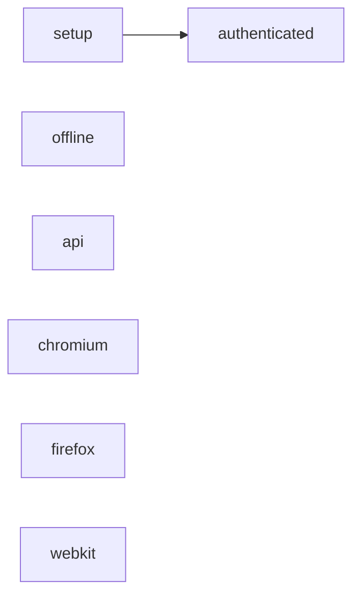
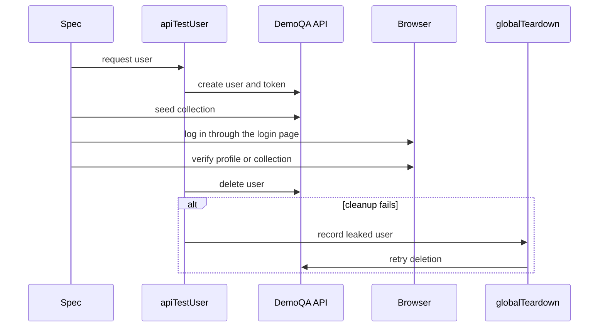
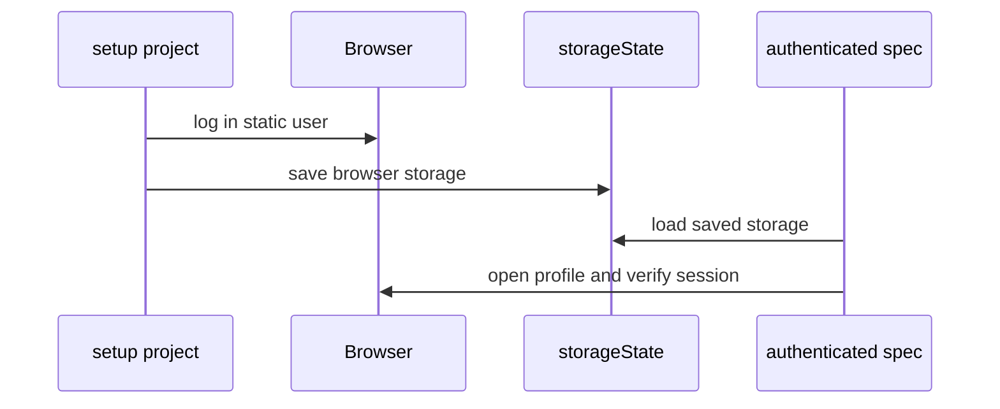

# Architecture

This document describes how the framework is composed and how data moves through a
test. The [test strategy](test-strategy.md) explains why each layer exists and when
it runs.

## Composition

Page objects describe user-facing workflows. Reusable widgets live in components so
the same behavior is not copied between pages.

`BasePage` owns navigation and the shared `Header`. `BookStorePage` and
`ProfilePage` each compose a `BooksTable`, because both screens render a book grid
inside a different wrapper. `ProfilePage` also composes `ConfirmDialog` for delete
confirmations.

`BooksTable` receives the wrapper selector for its page. Book Store uses
`div.books-wrapper table`; Profile uses `div.profile-wrapper table`. A mismatched
wrapper matches nothing, so assertions must prove the table is visible before
interpreting an empty result.

## Playwright projects

Projects separate deterministic checks from live traffic and keep authenticated
browser state in one place.

| Project             | Depends on | What it runs                                             | External traffic  |
| ------------------- | ---------- | -------------------------------------------------------- | ----------------- |
| `offline`           | none       | Recorded contracts and the stubbed API client            | No                |
| `api`               | none       | Live account and Book Store API workflows                | DemoQA API        |
| `chromium`          | none       | UI and hybrid tests, excluding `*.authenticated.spec.ts` | DemoQA UI and API |
| `setup`             | none       | Logs in the static user and writes `storageState`        | DemoQA UI         |
| `authenticated`     | `setup`    | Non-mutating specs that reuse the saved session          | DemoQA UI         |
| `firefox`, `webkit` | none       | The same UI scope as Chromium                            | DemoQA UI and API |

`authenticated` loads the storage state created by `setup`. Chromium, Firefox, and
WebKit ignore authenticated, API, and offline files so the same spec is not executed
by the wrong project.

## Isolated hybrid flow

Mutating browser scenarios create their own user. API setup finishes before the UI
login because DemoQA can invalidate the browser session if collection changes happen
after authentication.

`loginViaUi()` performs that login in the current browser context. It does not write
`storageState`, because the user exists only for the current test.

## Reused authenticated session

Non-mutating smoke checks can share one static user. The setup project authenticates
once, and dependent tests start already logged in.

This session must not be used to add or delete books. Those mutations would be shared
by every test reusing the same account.

## Contract boundary

`ApiHelpers` validates outgoing payloads before sending them and returns response
bodies as `unknown`. The caller parses the schema that matches the scenario:

- API and offline contract tests use strict schemas and reject unexpected fields.
- Fixtures use loose envelopes and require only the identifiers they consume.

The offline suite proves that split with the same drifted payload: the strict
contract fails, while the setup envelope still passes.
